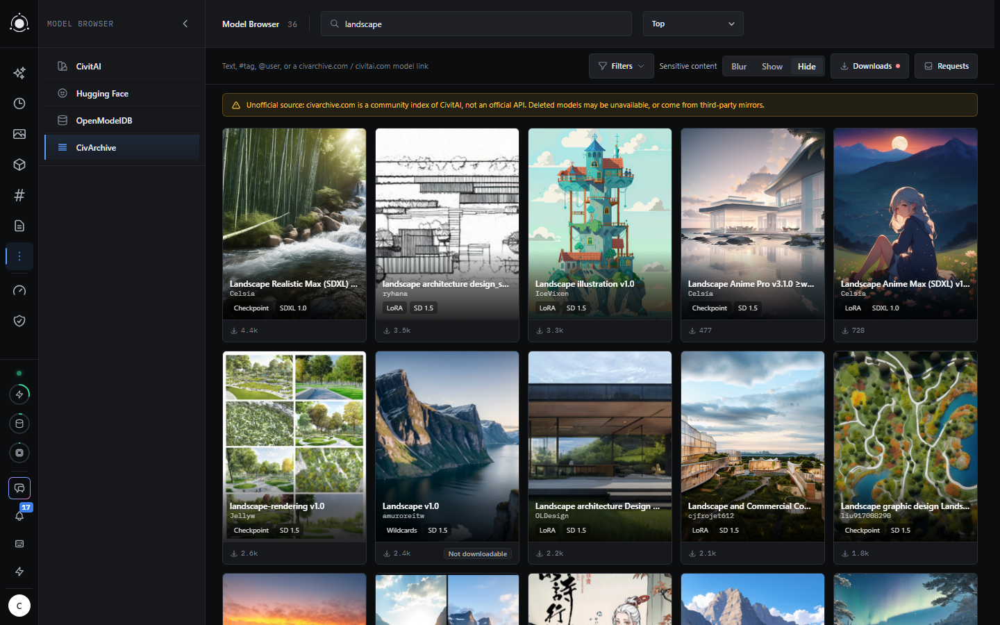
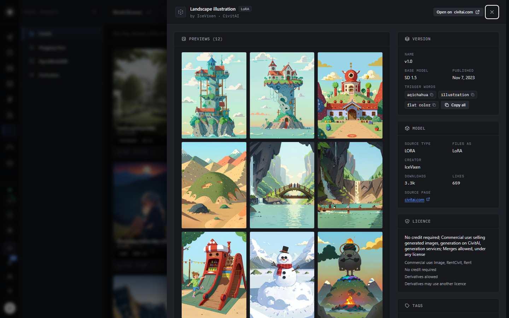
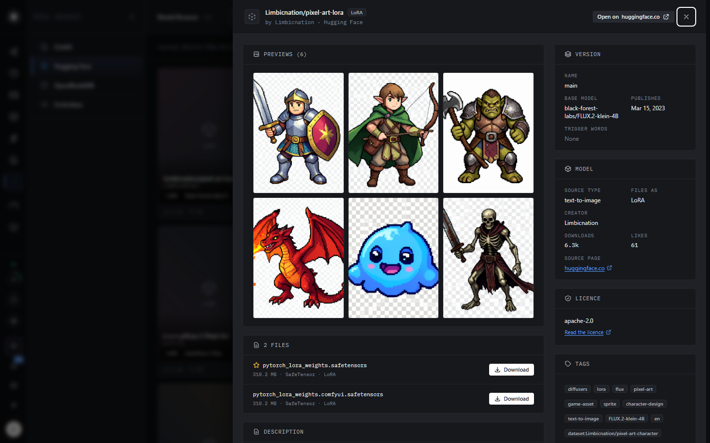
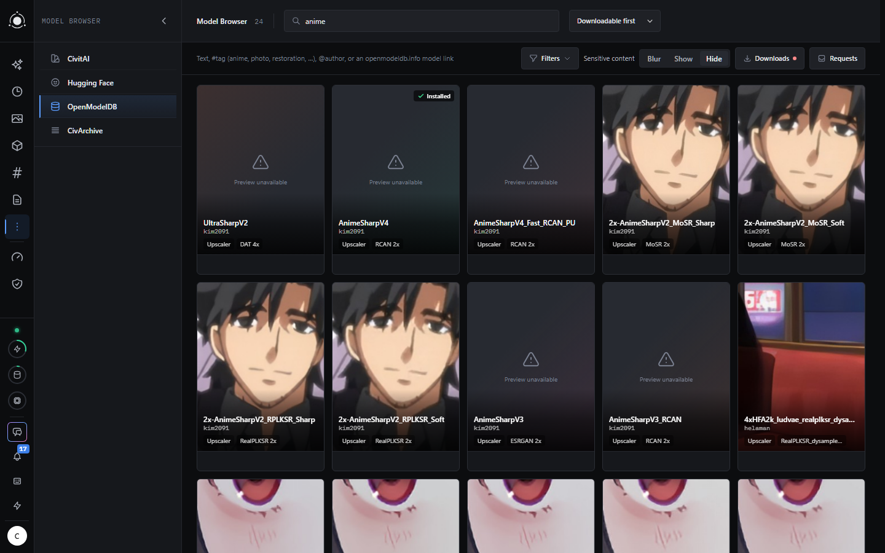
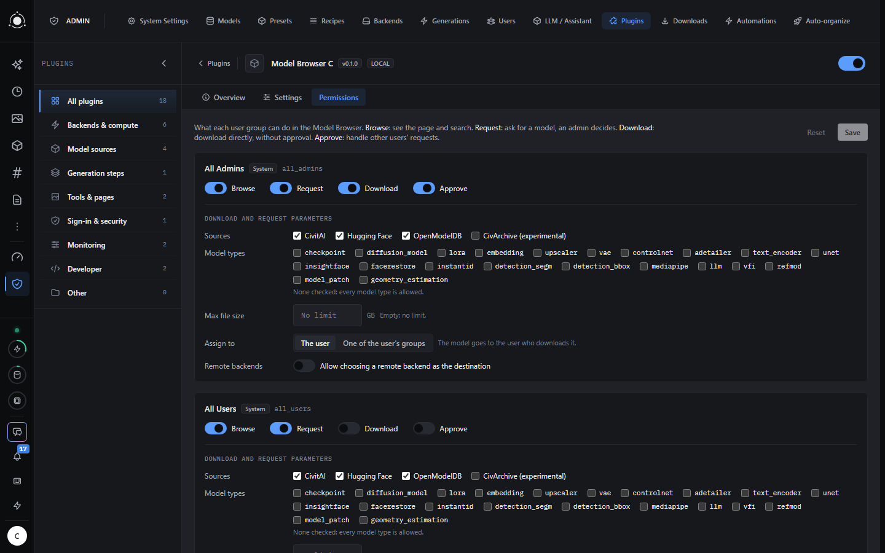
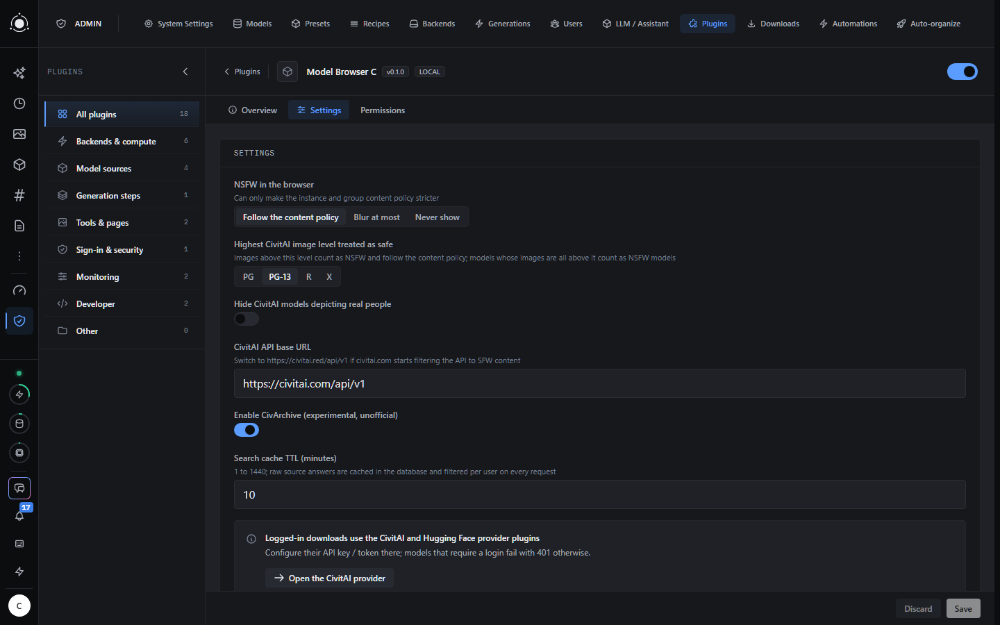

# Model Browser C

A [PotionUI](https://github.com/PotionUI/PotionUI) plugin to browse models on CivitAI, Hugging Face,
OpenModelDB and CivArchive from inside PotionUI, and download the file you pick into the right model
folder through PotionUI's own download queue. The model then shows up on the Models page with its
description, previews, tags, base model and licence filled in.

Admins decide per user group who may browse, request or download, from which sources, which model
types and up to which size. Users without download rights can request a model, and an admin
approves or declines the request. Monthly quotas go through PotionUI's plans. Everything follows the
instance's NSFW content policy.

This is the Model Browser with the CivArchive source, which is off by default. The Model Browser
of the PotionUI marketplace has no CivArchive source. The two plugins share their data and cannot be
enabled together.

## Requirements

**PotionUI 0.0.16 or newer**, or, until 0.0.16 is released, PotionUI's `master` branch from commit
[`3b3b78a2`](https://github.com/PotionUI/PotionUI/commit/3b3b78a2) (2026-10-14) on. The plugin does not
load on 0.0.15 or older: it needs the plugin API exports and the `download.after_complete` hook of
[PotionUI#11](https://github.com/PotionUI/PotionUI/pull/11), and its on/off settings rely on the fix of
[PotionUI#12](https://github.com/PotionUI/PotionUI/pull/12).

## Screenshots

Searching CivArchive, with the notice it shows as an unofficial source:

A CivitAI model: versions, previews, trigger words, files, licence:

A Hugging Face repository, with the previews taken from its model card:

OpenModelDB upscalers, with the models already installed marked as such:

Rights per user group, in Admin → Plugins → Model Browser C → Permissions:

Settings:

## Installing

1. Place this repository's content in `content/plugins/local/model-browser-c` of your PotionUI
   installation, for example with
   `git clone https://github.com/M4-S4/model-browser-c content/plugins/local/model-browser-c`.
2. Admin → Plugins → Scan for Plugins, then enable **Model Browser C**. Disable the Model
   Browser first if it is enabled.
3. Read the plugin's help page ([README.md](../README.md), also shown inside PotionUI from the
   plugin's Overview tab) before turning CivArchive on.

## Licence

GPL-3.0, like PotionUI ([LICENSE](../LICENSE)).
